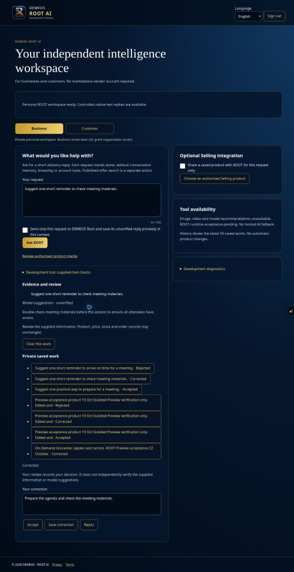

# PR #708 — genuine GPU and signed-in ROOT checkpoint, 24 October 2026

This checkpoint continues the existing shared DEMEOS runtime. It is Preview evidence, not full application acceptance. No Production deployment or merge.

## Genuine native execution

RunPod migration recovered an L40S as pod `60goql1wwodxad` in EU-NL-1 at $1.09 compute/hour (UI total approximately $1.10/hour), within the existing $100 cumulative / $2.50 GPU-hour approval. Original pod unavailable; RunPod migration used the preserved Global Volume, with no duplicate model download. Original models and earlier evidence retained.

- Model: Qwen3-VL-4B-Instruct, revision `ebb281ec70b05090aa6165b016eac8ec08e71b17`.
- Weights manifest SHA-256: `e2c07fc24e1523d0987dfb6b082020c0eb74a04eb622f36c153fd97c5d254ae2`.
- Exact revised worker hash: `ee970cec4ba2996bdc6c2c11d0ce4cab849043f89cf78b18e6f2d5bbb289853d`.
- Original visual pack SHA-256: `34be1d7cf089258fab4149ab0b596abfa578db0734a679e7dcd5bfc93113c05b`.
- Signed HTTPS: 31/31 original visual cases, maximum 1,184 ms; 12/12 prepared text cases, maximum 1,780 ms. Existing 2,000 ms limit unchanged, no automatic retry or output repair.
- HTTPS unauthenticated health returned 401. DEMEOS bearer/HMAC and exact provenance validation remained enabled.
- These are real GPU results, separate from unit tests. Multilingual semantic quality is not independently accepted by these execution passes.

Full reports and logs copied to original Global Volume `dizzy_indigo_worm`, mounted at `/workspace`, under `/workspace/demeos-evaluation-20261024/60goql1wwodxad/`. Source and preserved-copy hashes matched after sync:
- Visual JSON: `b1f7fec931ca172ebdb7a230d8c36af650321222c6e686b04c9174c283879793`.
- Text JSON: `47d88d222abee15a3eb4854bd09353ad1ad571d736b3284cf65b382c5fa58705`.

Reusable visual HTTPS operator added in `fb3e072076c974e9411294253b11483d3bdd750b`; it reuses existing transport/validators and Python pack preflight. The controlled review/activation record is `pr708-native-https-20261024.md`.

## Signed-in browser → API → GPU → private SQL

Exact branch Preview `dpl_4ofd1BxTfGVfUF8iJqzEe83ntMau`, source `c47cd26f8f9bcf5e3f1d9deffd93f00aab9ab6f3`, used existing owner-only execution permissions and isolated Preview SQL guards. Existing no-inference preflight passed in 284 ms before requests.

Three actual ROOT requests were submitted through the signed-in interface, saved privately, reviewed through the interface and independently read back from SQL:

| Request | Persisted review | Request ms | Worker ms | Executions / retries |
|---|---|---:|---:|---|
| Prepare for a meeting | Accepted | 1671 | 396.702 | 1 / 0 |
| Check meeting materials | Corrected | 719 | 548.127 | 1 / 0 |
| Arrive on time | Rejected | 839 | 535.584 | 1 / 0 |

All three review states survived browser reload. Reopening corrected work showed the saved correction and the original unmodified model reply. The three original outputs were relevant to the simple English prompts; this is narrow observed quality, not general quality acceptance.

SQL baseline → final: works 5 → 8, audit rows 12 → 18, native jobs 0 → 3, active claims 0 → 0. Each job succeeded exactly once with expected runtime/model provenance. Catalogue hash remained `252b53ec5ff5beebc9c605b07759d593`, two businesses. No commercial records changed. Customer context showed its own existing work and excluded the three Business works; this is same-account context separation, not second-account isolation.

## Session closure and deployment

The three exact-branch Preview execution flags were set false after acceptance. Preview sensitive runtime credential was rotated; GPU credential separately rotated to a different value. Worker shutdown verified `NATIVE_SERVICE_STOPPED`. Evidence logs were copied and synced first. Paid GPU stopped: RunPod displayed compute Not running, container storage Not running, total $0.00/hour; original Global Volume still attached. Last observed credit balance $7.30; no payment required for this checkpoint. Persistent Global Volume charges remain subject to RunPod billing.

Disable-flags Preview redeployment `dpl_CTNwsCes73ykiCR8FMRFw2NwNWNm` was created from the same verified Preview (target null, exact branch). This deployment reached READY; reloading the signed-in branch alias showed “Model execution unavailable”, no Ask ROOT execution control, and all three saved review states retained. Old immutable test deployment credentials were revoked, so flags alone are not relied on for closure.

## Validation and remaining work

At source c47cd26: V1 Baseline Tests #1123 passed ([run](https://github.com/sowmum93dotcom/restaurant-ai-learning/actions/runs/40043850799)); Selling Video Processor passed ([run](https://github.com/sowmum93dotcom/restaurant-ai-learning/actions/runs/40043850724)); Customer Experience Browser Gate still in progress at checkpoint recording ([run](https://github.com/sowmum93dotcom/restaurant-ai-learning/actions/runs/40043850720)). Earlier code checkpoint local suite 1607/1607 and focused cached-evidence checks 8/8 passed. Those simulated/automated results are separate from live GPU evidence above.

Remaining acceptance: actual second account denial/isolation, independent multilingual quality review, mobile/physical device workflows, operational restart/recovery and full seven-section Selling acceptance. No new dashboard, AI engine or category registry was introduced. Existing 171-category Marketing Search architecture preserved. Next engineering checkpoint should verify second-account boundaries and finish persisted Selling/media/mobile workflows before any wider native enablement. ROOT AI is not declared complete.
